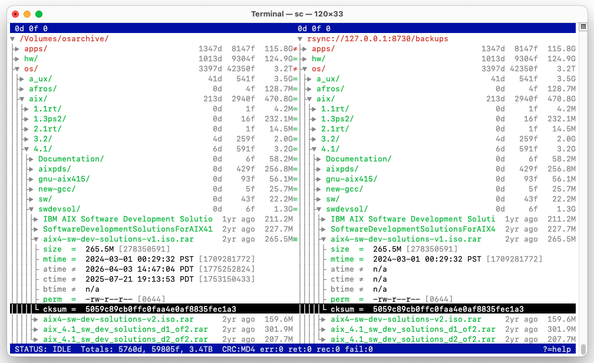

# Sync Commander

A tool for manual comparison, inspection, verification and troubleshooting of file/directory tree synchronization. Like Norton Commander or Midnight Commander but for sync.



- Out of band verification and inspection of dir sync tree.
- Manual comparison, touch up and maintenance.
- Troubleshooting, debugging sync issues.
- Ad hoc downloads/uploads. Touch up.
- Remote checksum generation and comparison.

## Features

- Manual Rsync / Rclone by hand.
- Remote checksum calculation via variety of protocols.
- Parallel copies.
- Batch copies for small files.
- Mouse: wheel moves the cursor, click selects, double-click or a click on the arrow expands/collapses; `-mouse=false` to disable.

## Bandwidth limit

`-bwlimit 4M` caps both directions (`-bwlimit-in` / `-bwlimit-out` to differ);
0 is unlimited and it is also adjustable live in the settings dialog (`=`).
It is applied at the socket for network protocols and at the file for local
and `fake://` trees, so every protocol shares one budget.

## Parallel copies

A copy moves 4 files at once. Start with another number with `-parallel 8`,
or set it in the settings dialog (`=`). While a copy runs, `+` adds one more
file in flight and `-` takes one away, up to 64. `-` never stops a file
mid-way: the next file to finish is simply not replaced, and the popup shows
`[5→3 in flight]` until it settles. sftp, scp, rsync+ssh and ftp open or close
a connection per file to match. A batch rsync+ssh transfer is one session, so
`+` and `-` do nothing there.

## Copy safety

A folder copy deletes nothing that is only on the destination unless you
choose it. When the destination folder holds files the source does not, `>`
and `<` name the first few and ask: `c` copies and keeps them, `d` copies
and deletes them (a mirror), `Esc` cancels. A mirror deletes only what the
dialog showed, and only while it is still as shown. An entry that came
later, in a folder the scan had not listed, or that changed since, stays,
and the next copy asks.

A copy never puts an older or smaller file over a newer or larger one
without asking. It names such files and asks: `y` overwrites them, `s`
skips them and copies the rest, `Esc` cancels. One that the copy finds
only while it runs, in a folder the scan had not listed, is not written:
it fails, and the next copy asks.

Deleting a file or folder that is on both sides asks which side: `a` left,
`l` right, `b` both. Enter does nothing there.

Mirror copy only deletes destination-only files when every copy in the run
succeeded; a copy also lists any unscanned subtree first, so it skips no
file there. Resumed (appended) copies are checksum-verified and recopied
in full on mismatch — disable with `--verify-resume=false`.

A restic repository is a backup: sc deletes nothing in one over restic://,
a mirror's deletes included, unless started with `-restic-delete`. A
restic:// path with no repository (no `config`) is refused, because
`rclone serve restic` answers a mistyped path as an empty repository; start
sc with `-restic-new` to copy a repository into an empty path. Its
`data/` shows as restic stores it on disk, `data/<first two characters>/<name>`,
so a repository folder and the same repository over restic:// compare name
for name.

## Supported protocols and checksums

| Protocol | Checksum |
| --- | --- |
| Local dir including remote mounts | XXH3, SHA256, MD5 |
| ftp:// ftps:// ftpes:// with implicit/explicit TLS | XSHA256, XSHA1, XMD5, HASH (SHA-256, SHA-1, MD5) |
| sftp:// scp:// ssh:// | SHA/MD5 (over ssh) |
| rsync://, rsync+ssh:// | Rsync MD4 (internal), SHA/MD5 (over ssh) |
| webdav://, webdavs:// | MD5/SHA1 (`rclone --etag-hash`) |
| restic://, restics:// | SHA256 |
| rclone:// any rclone remote (S3, B2, Swift, SMB, Dropbox, ...) | whatever the remote offers: MD5, SHA1, SHA256, XXH3 |
| fake:// synthetic tree (testing) | XXH3, SHA256, SHA1, MD5, MD4 |

## Server examples

- `rclone serve webdav --etag-hash md5`
- `rclone serve restic`

## rclone remotes

`rclone://` hands everything after the scheme to rclone, so any named remote
from `rclone.conf` or any connection string works. An encrypted `rclone.conf`
takes its password from `RCLONE_CONFIG_PASS` or `RCLONE_PASSWORD_COMMAND`: sc
never asks for it, since the TUI holds the terminal.

```
sc rclone://gdrive/Photos /backup/photos            # named remote
sc "rclone://:s3,provider=AWS,access_key_id=K,secret_access_key=S:bkt/p" /tmp/x
```

Checksums come from whatever the remote already stores — free from the listing
on object stores, over ssh on sftp — never by downloading. Remotes that keep
none (crypt, http, smb, ftp) compare by size and mtime only.

Built-in backends are local, s3, b2, swift, crypt, http, smb, dropbox and
onedrive; build with `-tags rclone_all` (`make build-all`) for all 68. Resuming an
interrupted upload is not supported on these remotes, and on object stores the
mtime shown is the server upload time — set `RCLONE_USE_SERVER_MODTIME=false`
for the exact one at the cost of a request per file.

## Synthetic trees for perf testing

`fake://` generates a directory tree in memory — nothing on disk, nothing on the
wire. Every attribute is derived from a hash of the path, so a 1M-object tree
costs no memory until it is listed, and two `fake://` sides with the same
parameters compare as identical.

```
sc fake://huge fake://huge                      # ~1M objects per side
sc fake://large 'fake://large?diff=0.1&drop=0.02'  # 10% differing, 2% missing right
sc 'fake://x?dirs=8&files=25&depth=5&latency=20ms' /tmp/x   # simulated network RTT
sc -pprof localhost:6060 fake://huge fake://huge           # then: go tool pprof
```

Presets (host): `tiny` ~140, `small` ~3k, `medium` ~48k, `large` ~240k,
`huge` ~1M, `insane` ~4.5M objects. Parameters override the preset:
`dirs`, `files`, `depth`, `seed`, `size`, `vary`, `drop`, `dropdirs`, `diff`,
`latency`, `cklatency`, `nodata`.

Writes land in an in-memory overlay, so `fake://` also works as a copy target.

Timing harness: `SC_PERF=fake://huge go test ./model -run TestPerfScan -v`
